# Visible evidence: UI review for PR #976

Before: merged media-correction base `5f61fa77ce369550e31c627b20deced429216700`.
After: locally qualified product commit `3b649191d689a835df8ba744187438285639b799`.

The captures use the actual repository image bytes, not the generic image fixture used by the existing deterministic visual regression suite. Desktop viewport: 1440×1000. Mobile viewport: 390×844. Light theme; reduced motion.

## card-back-desktop

| Before | After |
|---|---|
| 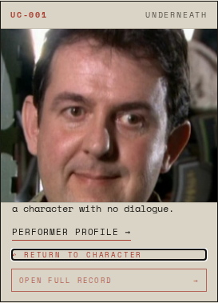 | 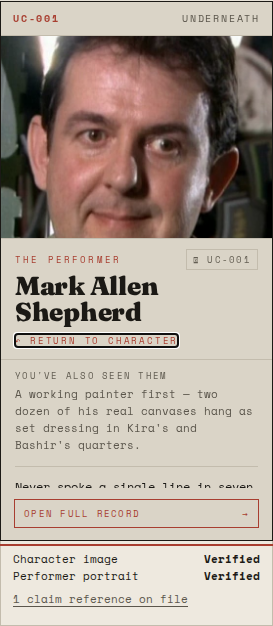 |

## card-back-mobile

| Before | After |
|---|---|
| 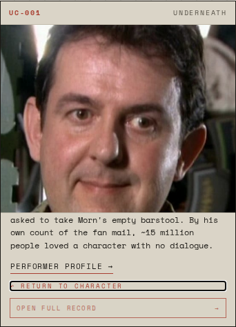 | 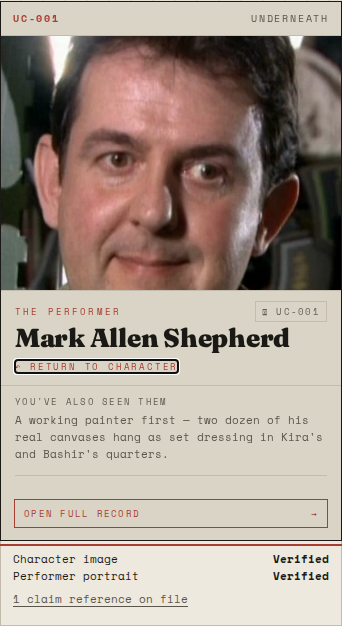 |

## card-front-desktop

| Before | After |
|---|---|
| 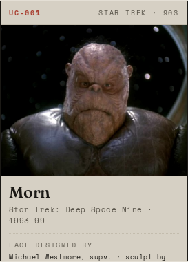 | 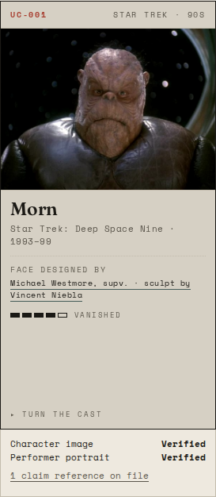 |

## card-front-mobile

| Before | After |
|---|---|
| 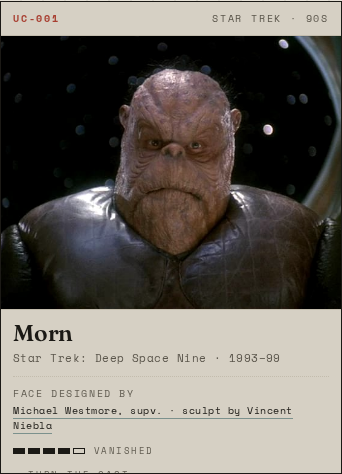 | 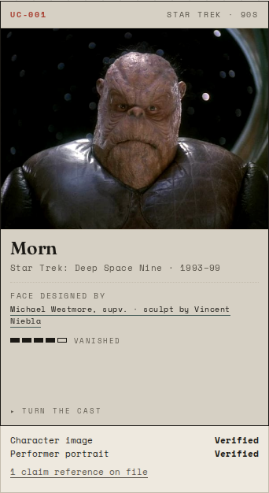 |

## connections-desktop

| Before | After |
|---|---|
| 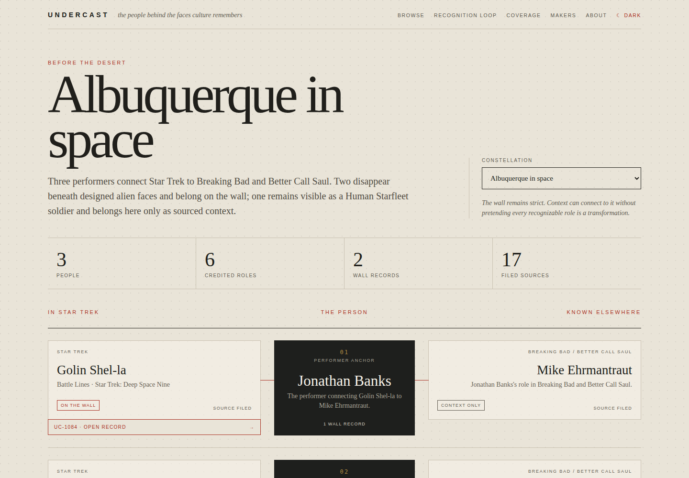 |  |

## connections-mobile

| Before | After |
|---|---|
| 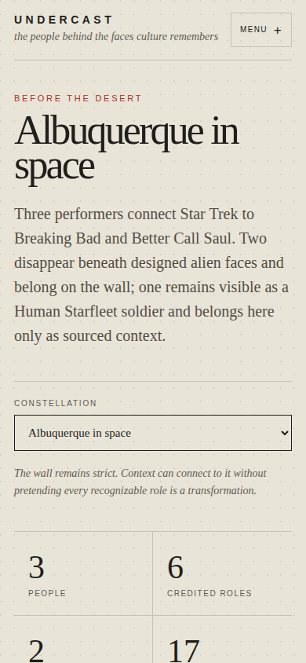 |  |

## coverage-desktop

| Before | After |
|---|---|
| 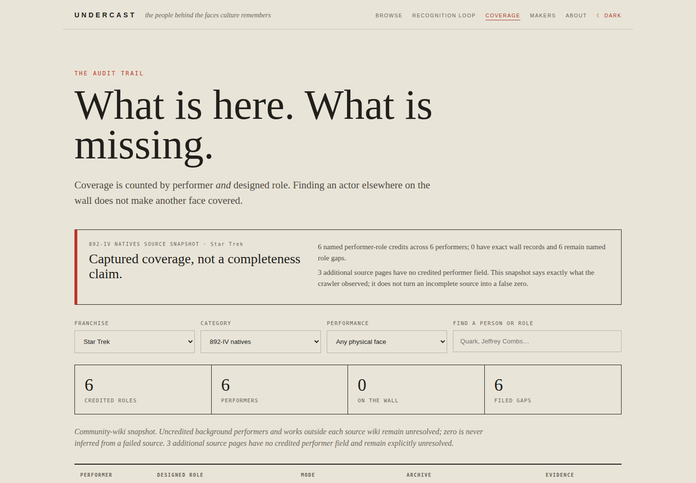 |  |

## coverage-mobile

| Before | After |
|---|---|
|  | 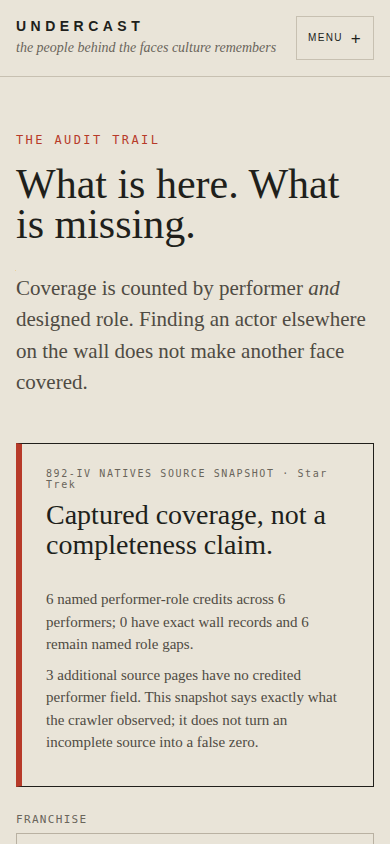 |

## recognition-desktop

| Before | After |
|---|---|
|  | 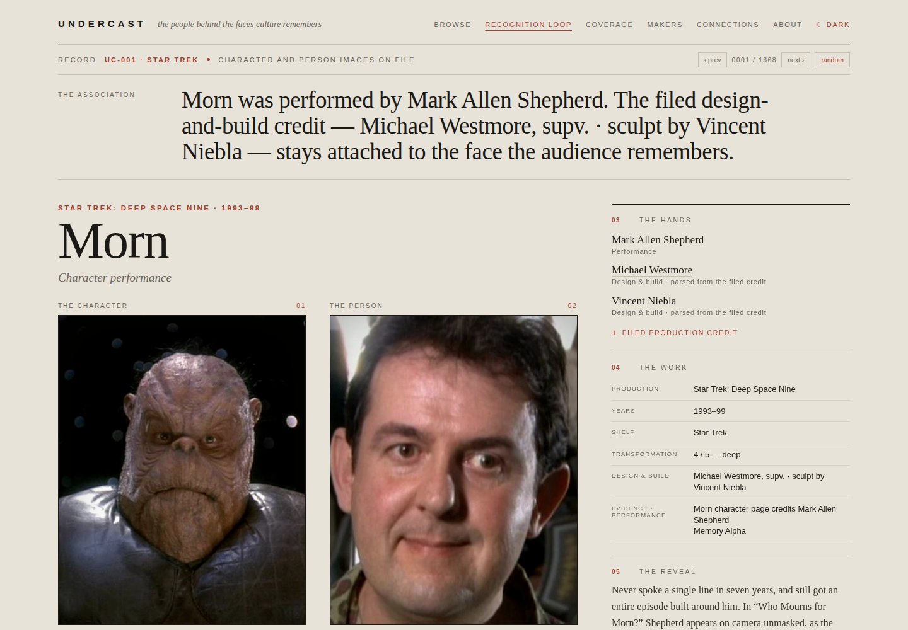 |

## recognition-mobile

| Before | After |
|---|---|
|  | 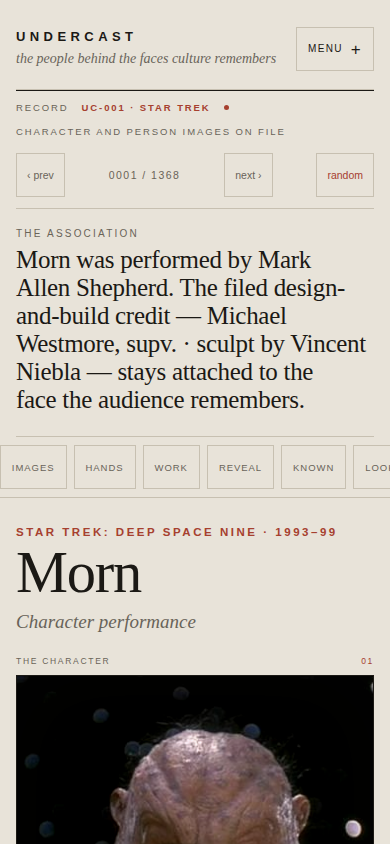 |

## record-desktop

| Before | After |
|---|---|
|  | 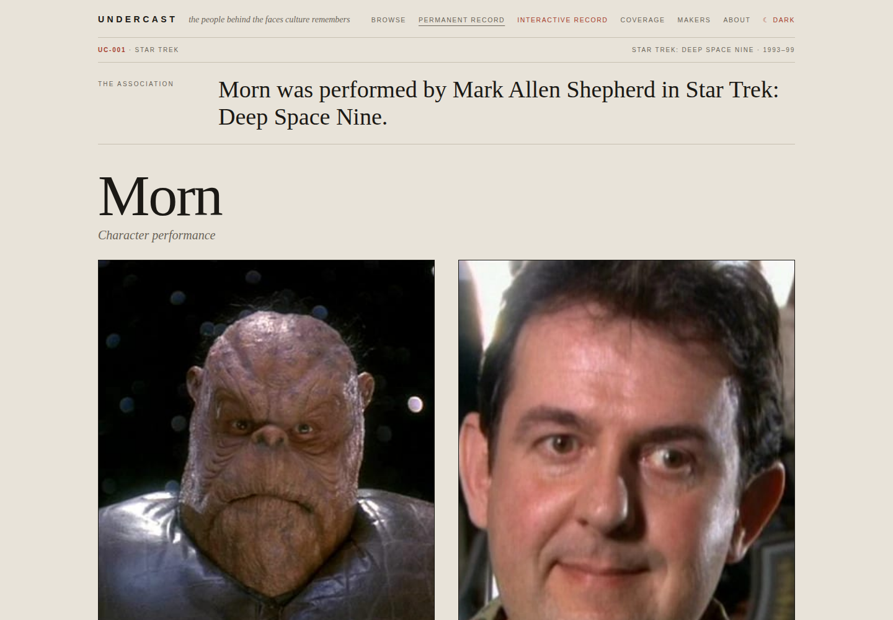 |

## record-mobile

| Before | After |
|---|---|
|  | 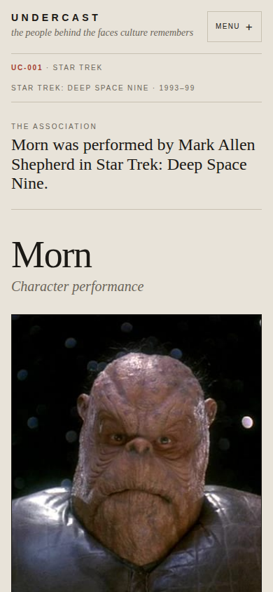 |

## recovery-desktop

| Before | After |
|---|---|
| 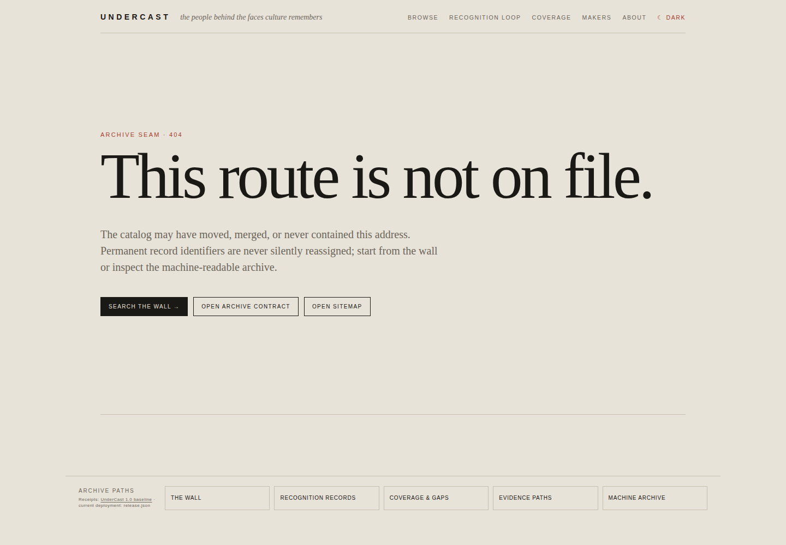 | 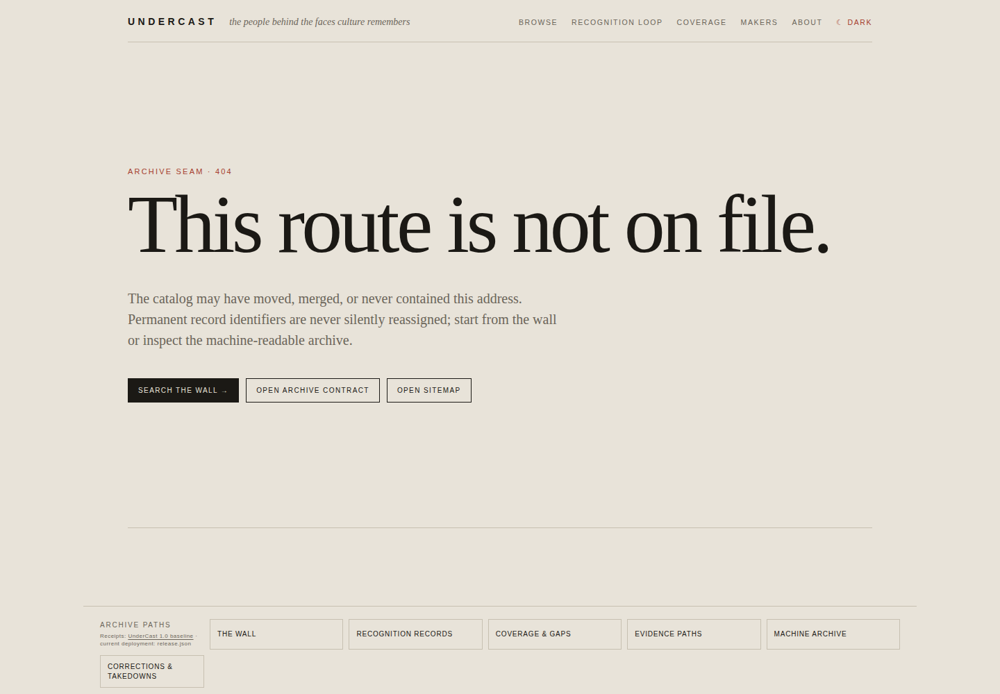 |

## recovery-mobile

| Before | After |
|---|---|
| 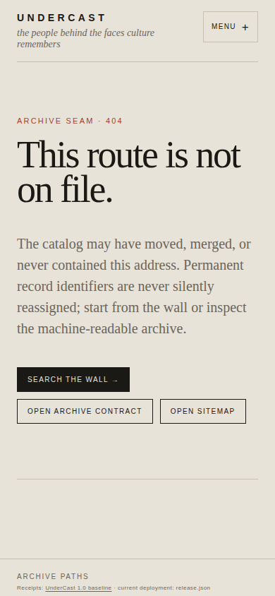 |  |

## wall-desktop

| Before | After |
|---|---|
|  | 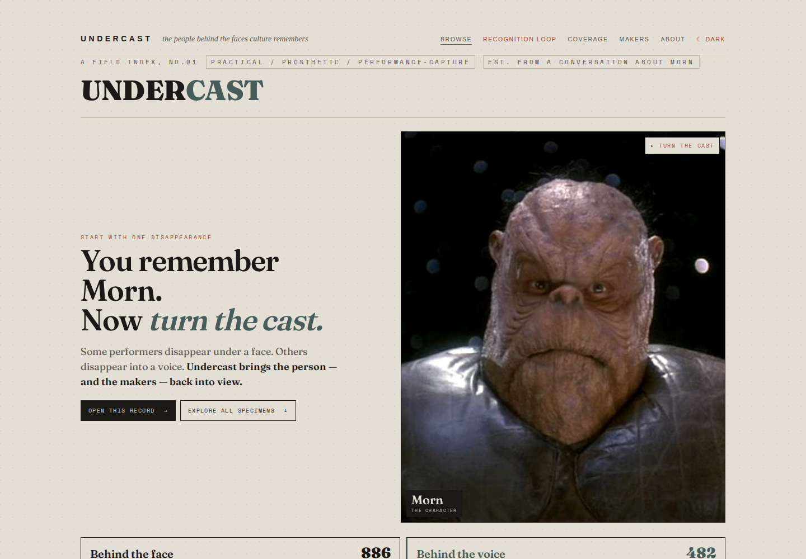 |

## wall-mobile

| Before | After |
|---|---|
|  | 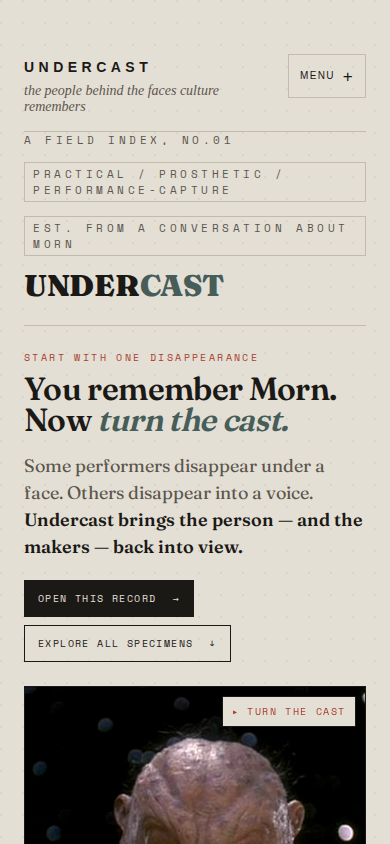 |

Full canonical gate on the product commit: 27/27 steps; 29 desktop + 15 mobile + 9 visual tests passed. The existing visual baselines were unchanged. These images document presentation, not new identity adjudication.
